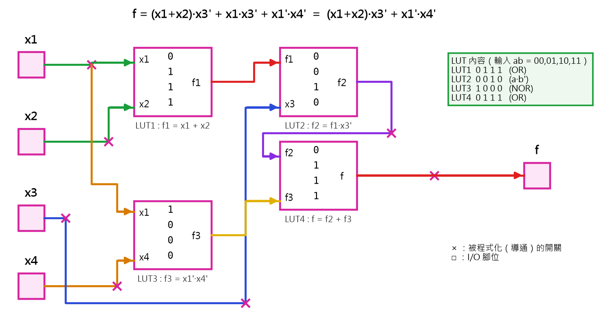
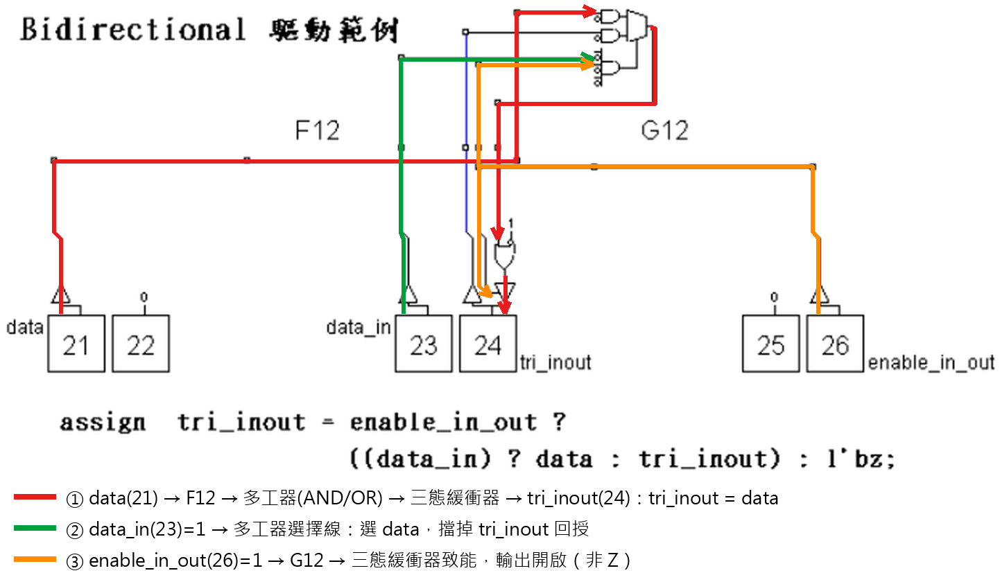
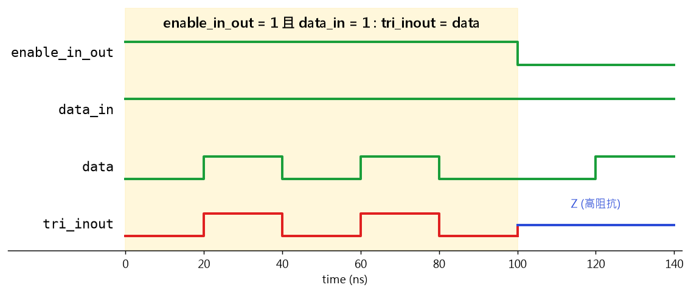

# 115 學年度第一學期「高等 FPGA 系統設計」期中考 — 解答

> 每一題的程式都放在對應資料夾，已用 ModelSim (Intel FPGA Starter 2020.1) 實際模擬驗證。
> **注意：ModelSim 不支援中文路徑**（`期中考` 資料夾內直接 `vlib work` 會出現 `sqlite3_open ... unable to open database file`），
> 請先把 `Q1_FullAdd` 等資料夾複製到全英文路徑（例如 `D:\midterm\Q1_FullAdd`）再執行 `do run.do`。

| 題號 | 資料夾 | 驗證結果 |
|---|---|---|
| 1 | [Q1_FullAdd](Q1_FullAdd/) | 8/8 組合 PASS |
| 2 | [Q2_FPGA_LUT](Q2_FPGA_LUT/) | 16/16 組合與原式相同 PASS |
| 3 | [Q3_bin2gra](Q3_bin2gra/) | 256/256 組合 PASS |
| 4 | [Q4_Bidirectional](Q4_Bidirectional/) | tri_inout = data（波形見下） |
| 5 | [Q5_Case_TwosComp16](Q5_Case_TwosComp16/) | (A)(B) 比較結果見下；(C) 65536/65536 PASS |

---

## 第 1 題　ModelSim 模擬過程（20%）

已知設計檔 `FullAdd.v`（全加器）與測試平台 `FullAdd_test.v`，ModelSim 的模擬流程如下：

**步驟 1：建立專案／切換工作目錄**
- 開啟 ModelSim → `File > New > Project...`，輸入專案名稱（如 `FullAdd`）、Project Location 選放檔案的資料夾（路徑不可含中文），Default Library Name 用 `work` → OK。
- （不建專案也可以：`File > Change Directory...` 切到檔案所在資料夾即可。）

**步驟 2：建立工作函式庫**
- 專案模式會自動建立；指令模式為：`vlib work`、`vmap work work`。

**步驟 3：加入檔案**
- `Add Existing File...` → 選取 `FullAdd.v` 與 `FullAdd_test.v` 加入專案。

**步驟 4：編譯（Compile）**
- `Compile > Compile All`（指令：`vlog FullAdd.v FullAdd_test.v`）。
- Project 視窗中 Status 欄出現綠色 ✔ 表示編譯成功；出現紅色 ✘ 則在 Transcript 視窗雙擊錯誤訊息修正後重新編譯。
- 編譯後兩個模組會出現在 Library 視窗的 `work` 函式庫中。

**步驟 5：載入模擬（Simulate）**
- `Simulate > Start Simulation...` → 展開 `work` → 選擇 **測試平台頂層模組 `FullAdd_test`**（不是 `FullAdd`），取消 Enable optimization 或加上 `-voptargs=+acc` 以便觀察內部訊號 → OK。
- 指令：`vsim -voptargs=+acc work.FullAdd_test`

**步驟 6：加入波形**
- 在 Objects 視窗選取訊號（A、B、Cin、S、Cout）→ 右鍵 `Add Wave`（指令：`add wave -r /*`）。

**步驟 7：執行模擬**
- `Simulate > Run > Run -All`（指令：`run -all`，或 `run 100ns` 指定時間）。
- 測試平台以 `$finish` 結束模擬。

**步驟 8：觀察與驗證結果**
- Wave 視窗：檢查波形，可用游標（Cursor）量測時間、切換數值顯示格式（Radix）。
- Transcript 視窗：檢視 `$display` / `$monitor` 印出的結果。
- 本題實際模擬輸出：

```
 time  A B Cin | Cout S
   10  0 0  0  |  0   0
   20  0 0  1  |  0   1
   30  0 1  0  |  0   1
   40  0 1  1  |  1   0
   50  1 0  0  |  0   1
   60  1 0  1  |  1   0
   70  1 1  0  |  1   0
   80  1 1  1  |  1   1
PASS: all 8 cases correct
```

**步驟 9：修改與重新模擬**
- 修改程式後重新編譯，再輸入 `restart -f` 、`run -all`；結束模擬用 `quit -sim`。

以上步驟可寫成腳本 [run.do](Q1_FullAdd/run.do)，在 Transcript 輸入 `do run.do` 一次完成：

```tcl
vlib work
vmap work work
vlog FullAdd.v FullAdd_test.v
vsim -voptargs=+acc work.FullAdd_test
add wave -r /*
run -all
```

---

## 第 2 題　FPGA 電路圖（20%）

**化簡：**

$$f=(x_1+x_2)\bar{x}_3+x_1\bar{x}_3+\bar{x}_1\bar{x}_4$$

因為 $x_1\bar{x}_3 \subseteq (x_1+x_2)\bar{x}_3$（吸收律），所以

$$f=(x_1+x_2)\bar{x}_3+\bar{x}_1\bar{x}_4$$

**以第一章第 36 頁的 2 輸入 LUT 架構分解：**

| LUT | 輸入 (a, b) | 功能 | 儲存內容（ab=00,01,10,11） |
|---|---|---|---|
| LUT1 | x1, x2 | f1 = x1 + x2 | 0 1 1 1 |
| LUT2 | f1, x3 | f2 = f1·x3' | 0 0 1 0 |
| LUT3 | x1, x4 | f3 = x1'·x4' | 1 0 0 0 |
| LUT4 | f2, f3 | f = f2 + f3 | 0 1 1 1 |

$$f = f_2 + f_3 = (x_1+x_2)\bar{x}_3 + \bar{x}_1\bar{x}_4$$

**FPGA 電路圖（被程式化的 FPGA，× 為導通的繞線開關）：**



**真值表（模擬驗證，16 種輸入 LUT 電路 = 原式）：**

| x1x2x3x4 | f | x1x2x3x4 | f |
|---|---|---|---|
| 0000 | 1 | 1000 | 1 |
| 0001 | 0 | 1001 | 1 |
| 0010 | 1 | 1010 | 0 |
| 0011 | 0 | 1011 | 0 |
| 0100 | 1 | 1100 | 1 |
| 0101 | 1 | 1101 | 1 |
| 0110 | 1 | 1110 | 0 |
| 0111 | 0 | 1111 | 0 |

Verilog 結構模型：[FPGA_LUT_f.v](Q2_FPGA_LUT/FPGA_LUT_f.v)、測試：[FPGA_LUT_f_tb.v](Q2_FPGA_LUT/FPGA_LUT_f_tb.v)

---

## 第 3 題　bin2gra 的 Test bench（20%）

程式說明：`for` 迴圈算出 `Gry[i] = Bin[i] ^ Bin[i+1]`（i = 0 ~ 6），迴圈結束時 i = 7，再執行 `Gry[7] = Bin[7]`，
即 **Gray = Bin ^ (Bin >> 1)**。

```verilog
// bin2gra_test.v : bin2gra 的測試平台
`timescale 1ns/1ps
module bin2gra_test;
  parameter length = 8;

  reg  [length-1:0] Bin;
  wire [length-1:0] Gry;
  reg  [length-1:0] Gry_prev;
  integer k, err;

  // 被測電路（UUT）
  bin2gra #(.length(length)) UUT (.Gry(Gry), .Bin(Bin));

  // 計算向量中 1 的個數
  function integer ones;
    input [length-1:0] v;
    integer j;
    begin
      ones = 0;
      for (j = 0; j < length; j = j + 1) ones = ones + v[j];
    end
  endfunction

  initial begin
    err = 0;
    Bin = 0;
    #10 Gry_prev = Gry;
    $display("  Bin       Gry       expected");
    for (k = 0; k < (1 << length); k = k + 1) begin
      Bin = k;
      #10;
      if (k < 8 || k > (1 << length) - 4)
        $display("  %b  %b  %b", Bin, Gry, Bin ^ (Bin >> 1));
      if (Gry !== (Bin ^ (Bin >> 1))) begin          // 與標準公式比對
        err = err + 1;
        $display("  ERROR: Bin=%b Gry=%b", Bin, Gry);
      end
      if (k > 0 && ones(Gry ^ Gry_prev) != 1) begin  // 相鄰格雷碼只差 1 位元
        err = err + 1;
        $display("  ERROR: adjacent codes differ in more than 1 bit at Bin=%0d", k);
      end
      Gry_prev = Gry;
    end
    if (err == 0) $display("PASS: all %0d inputs correct", 1 << length);
    else          $display("FAIL: %0d errors", err);
    $finish;
  end
endmodule
```

模擬結果：

```
  Bin       Gry       expected
  00000000  00000000  00000000
  00000001  00000001  00000001
  00000010  00000011  00000011
  00000011  00000010  00000010
  00000100  00000110  00000110
  00000101  00000111  00000111
  00000110  00000101  00000101
  00000111  00000100  00000100
  11111101  10000011  10000011
  11111110  10000001  10000001
  11111111  10000000  10000000
PASS: all 256 inputs correct
```

---

## 第 4 題　enable_in_out = 1 且 data_in = 1 的訊號流動（20%）

```verilog
assign tri_inout = enable_in_out ? ((data_in) ? data : tri_inout) : 1'bz;
```

代入 enable_in_out = 1、data_in = 1：

$$tri\_inout = 1\ ?\ (1\ ?\ data : tri\_inout) : 1'bz = data$$

**訊號流動路徑：**

1. **紅色（資料路徑）**：`data`（pin 21）→ 輸入緩衝器 → F12 繞線 → 上方 AND-OR 多工器中「data」那一組 AND 閘 → OR 閘輸出 → 回繞到下方 OR 閘 → 輸出三態緩衝器 → `tri_inout`（pin 24）輸出。
2. **綠色（選擇線）**：`data_in`（pin 23）= 1 → 多工器選擇線：開啟 data 的 AND 閘，並經反相輸入關閉 tri_inout 回授（pin 24 輸入緩衝器 → AND 閘）那一路。
3. **橘色（致能）**：`enable_in_out`（pin 26）= 1 → G12 繞線 → 輸出三態緩衝器致能端，緩衝器導通，輸出不是高阻抗 Z。



**訊號波形（ModelSim 模擬）**：在 enable_in_out = 1、data_in = 1 期間（0 ~ 100 ns），tri_inout 波形與 data 完全相同；
enable_in_out 變 0 後輸出關閉，tri_inout = Z。



```
 time enable data_in data | tri_inout
    0    1      1      0   |    0
   20    1      1      1   |    1
   40    1      1      0   |    0
   60    1      1      1   |    1
   80    1      1      0   |    0
  100    0      1      0   |    z
  120    0      1      1   |    z
```

---

## 第 5 題　case / casex / casez 與 16 位元 2 的補數（20%）

這段程式的功能：找出 In_Data 中**最低位的 1**，該位元（含）以下不變、以上全部反相 → 就是 **8 位元 2 的補數**（Out_Data = −In_Data）。

### (A) 以 `?` 撰寫（5%）

| 關鍵字 | 是否正確 | 原因 |
|---|---|---|
| `case` | ✘ 錯誤 | `case` 做全等比對（含 x、z），`?` 等於 `z`，只有輸入位元真的是 z 才會匹配；一般 0/1 輸入全部落到 `default`，輸出 = 輸入 |
| `casez` | ✔ 正確 | `casez` 把 `z`／`?` 視為 don't care |
| `casex` | ✔ 正確 | `casex` 把 `x`、`z`／`?` 都視為 don't care |

→ **(A) casez 與 casex 正確（建議用 casez）。**

### (B) 以 `x` 撰寫（5%）

| 關鍵字 | 是否正確 | 原因 |
|---|---|---|
| `case` | ✘ 錯誤 | `x` 被當成實際的未知值比對，0/1 輸入不會匹配 |
| `casez` | ✘ 錯誤 | `casez` 只把 z/? 當 don't care，`x` 仍要完全相同 |
| `casex` | ✔ 正確 | 只有 `casex` 把 `x` 視為 don't care |

→ **(B) 只有 casex 正確。**

ModelSim 實測（256 種輸入與 −In_Data 比對的錯誤數，只有 In_Data = 0、128 兩個值 default 剛好答對）：

```
 In_Data  | -In      | A:case   A:casez  A:casex  | B:case   B:casez  B:casex
 00000001 | 11111111 | 00000001 11111111 11111111 | 00000001 00000001 11111111
 00000110 | 11111010 | 00000110 11111010 11111010 | 00000110 00000110 11111010
 01010000 | 10110000 | 01010000 10110000 10110000 | 01010000 01010000 10110000
errors out of 256 inputs:
  (A) ? pattern : case=254  casez=0  casex=0
  (B) x pattern : case=254  casez=254  casex=0
```

### (C) 16 位元 2 的補數 TwosComp16（10%）

```verilog
// TwosComp16.v : 16 位元 2 的補數
module TwosComp16 (In_Data, Out_Data);
  input  [15:0] In_Data;
  output [15:0] Out_Data;
  reg    [15:0] Out_Data;

  always @(In_Data)
    casez (In_Data)
      16'b???????????????1: Out_Data = In_Data ^ 16'hfffe;
      16'b??????????????10: Out_Data = In_Data ^ 16'hfffc;
      16'b?????????????100: Out_Data = In_Data ^ 16'hfff8;
      16'b????????????1000: Out_Data = In_Data ^ 16'hfff0;
      16'b???????????10000: Out_Data = In_Data ^ 16'hffe0;
      16'b??????????100000: Out_Data = In_Data ^ 16'hffc0;
      16'b?????????1000000: Out_Data = In_Data ^ 16'hff80;
      16'b????????10000000: Out_Data = In_Data ^ 16'hff00;
      16'b???????100000000: Out_Data = In_Data ^ 16'hfe00;
      16'b??????1000000000: Out_Data = In_Data ^ 16'hfc00;
      16'b?????10000000000: Out_Data = In_Data ^ 16'hf800;
      16'b????100000000000: Out_Data = In_Data ^ 16'hf000;
      16'b???1000000000000: Out_Data = In_Data ^ 16'he000;
      16'b??10000000000000: Out_Data = In_Data ^ 16'hc000;
      16'b?100000000000000: Out_Data = In_Data ^ 16'h8000;
      16'b1000000000000000: Out_Data = In_Data ^ 16'h0000;
      default:              Out_Data = In_Data;           // In_Data = 0
    endcase
endmodule
```

（等效的簡潔寫法：`assign Out_Data = ~In_Data + 16'd1;`）

模擬結果（65536 種輸入全測，並檢查 X + (−X) = 0）：

```
 In_Data (hex/dec) | Out_Data (hex/signed dec)
  0000 /     0     |  0000 / 0
  0001 /     1     |  ffff / -1
  0002 /     2     |  fffe / -2
  0068 /   104     |  ff98 / -104
  03e8 /  1000     |  fc18 / -1000
  7fff / 32767     |  8001 / -32767
  8000 / 32768     |  8000 / -32768
  ffff / 65535     |  0001 / 1
PASS: all 65536 inputs correct
```
